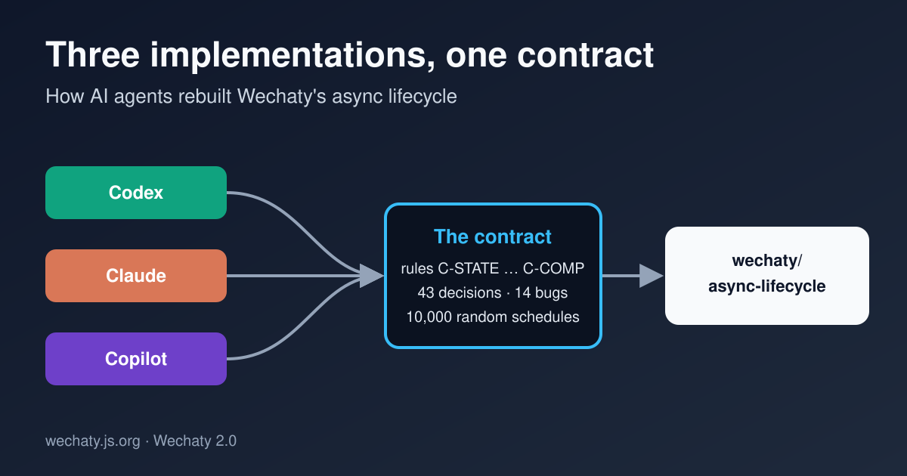
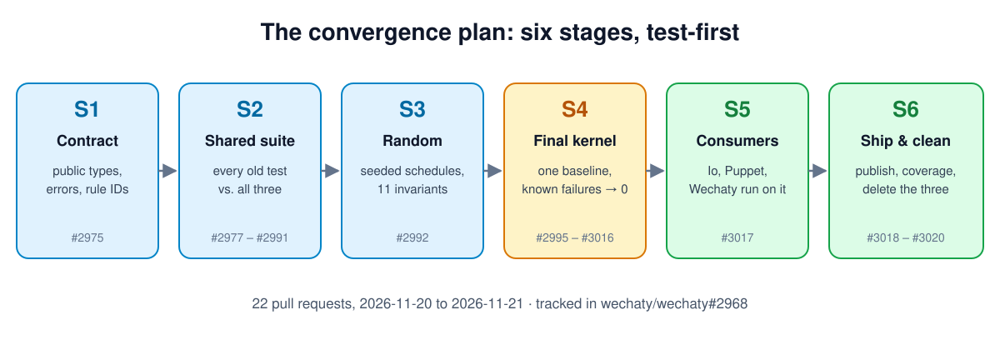
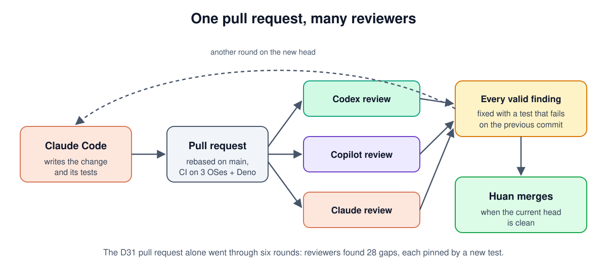

> **Written by Huan Li with Claude Code (Claude Opus 5.5).** I set the goals and made every decision. Claude Code did most of the engineering, and drafted this post from the issues and pull requests we wrote together. Codex, Copilot and Claude reviewed every pull request along the way. One section below is in Claude Code's own voice.



For ten years, Wechaty has answered "is this thing running?" with a small library I wrote, [`state-switch`](https://github.com/huan/state-switch). It served us well. But Wechaty grew from *watching* state into *orchestrating* fallible, concurrent, asynchronous resources, and a flag cannot do that job.

This November we replaced it. Not with a rewrite of `state-switch`, and not with the first implementation that looked right, but with something I had never tried at this scale: **three AI agents built the same module independently, and then one agent, working test-first against a shared contract, turned the three into one**, while the other agents reviewed every step.

It took 22 pull requests over two days. This post is the story of how, what the process caught, and what it taught us.

## The problem: a flag cannot own a lifecycle

Wechaty is a stack of async resources. A `Wechaty` bot owns a `Puppet` (for example `PuppetService`, a gRPC client to a `PuppetServer` that owns another Puppet) and an `Io` WebSocket client. Every layer starts, stops, becomes ready and recovers. Today each one does so with `state-switch` flags and hand-written `start()`, `stop()` and `reset()`.

The [RFC that started this work (#2905)](https://github.com/wechaty/wechaty/issues/2905) listed what goes wrong:

1. Concurrent `start()`, `stop()` and `reset()` race on mutable flags instead of converging on one desired state.
2. A startup that fails at step K leaks steps 1 to K−1.
3. Callbacks from an old run (stream errors, timers, watchdogs) restart a bot that the user had stopped.
4. Background loops outlive `stop()`.

None of these is a bug in a single line. They are what happens when a state *indicator* is asked to do the job of an operation *owner*. The RFC put it in one line: `state-switch` answers "what state is this component reporting?", but the new module must answer "who owns the work, what state do we want, how do we safely reach it, and how do we prove cleanup?"

## Three agents, one design, three different answers

The design itself was a multi-model effort. In [the API RFC (#2911)](https://github.com/wechaty/wechaty/issues/2911), Gemini, Copilot and ChatGPT each wrote a full API proposal, next to the one in the issue itself. Then came four reviews and a [consolidated v1 design](https://github.com/wechaty/wechaty/issues/2911#issuecomment-6873515089):

- **Generations.** Every run of a resource is a generation. Its work is fenced by a scope that becomes inert the moment the run starts retiring, so a stale callback cannot touch a newer run.
- **A ledger of obligations.** Everything a run acquires, spawns or defers is recorded before it can leak, and released in a fixed order: tasks first, then resources, newest first.
- **Commands record intent; one reconciler acts on it.** `start()`, `stop()` and `restart()` never race each other. They change what is wanted, and a single loop moves the real state toward it.
- **Mechanism in, policy out.** The kernel never retries on its own. Backoff, budgets and supervision belong to the code that uses it.

Then I asked three coding agents to implement it: [Copilot (#2912)](https://github.com/wechaty/wechaty/pull/2912), [Claude (#2913)](https://github.com/wechaty/wechaty/pull/2913) and [Codex (#2914)](https://github.com/wechaty/wechaty/pull/2914). All three were merged into `main` side by side, each in its own directory and with its own tests.

That is the trap. Three green test suites told me nothing about which implementation was right, because each one tested what its author thought the design meant. A ChatGPT progress review said it plainly: the three share one architecture, but **none of them is verified**. Build one shared contract suite, pick one kernel by evidence, and port improvements one test at a time.

So that became the plan.

## Don't merge the code. Merge the evidence

The plan started as an eight-step outline. Claude Code refined it into [#2968](https://github.com/wechaty/wechaty/issues/2968), and after I approved it, it ran as six stages. The rule for every stage: no behavior changes without a contract test that says what is right.



### S1: write the contract down

The first deliverable was not code but a document: [`src/async-lifecycle/README.md`](https://github.com/wechaty/wechaty/blob/main/src/async-lifecycle/README.md). Every rule has an ID, such as `C-CMD-07` ("`stop()` supersedes every pending start, restart and recovery") or `C-SCOPE-11` (what happens to a cleanup registered after its run has been released). Tests cite these IDs, and so does the TSDoc in the public types. Every change to a rule must change the README, get a decision ID, and update the tests that cite it.

By the end, decisions were numbered up to D43, each recorded with its reason in the decision log of #2968.

### S2: one suite, three subjects

Next, every test from the three implementations was ported into one shared contract suite, which runs each test against every implementation through a thin adapter, on both entry points, under both Node.js and Deno. An `INVENTORY.md` file records where each source test went: ported (with its contract test ID), covered by an existing test, or dropped with a reason.

The first results table was humbling. Of 235 contract tests:

| Implementation | Pass | Known failure | Skipped (missing feature) |
| --- | ---: | ---: | ---: |
| Codex | 128 | 31 | 76 |
| Claude | 181 | 53 | 1 |
| Copilot | 154 | 81 | 0 |

No implementation was "the right one". Codex had the best design for one of the hardest problems, cleanups that arrive late, but lacked six features of the contract. Copilot was the most complete in features, but its 81 failures came from 38 different causes. Claude ran almost the whole contract and passed the most, and most of its 53 failures came from a few concentrated causes.

The evidence decided the baseline (D40): **start from Claude's kernel, and port Codex's late-release design.**

### S3: let randomness find what examples miss

Hand-written tests only cover the interleavings someone thought of. S3 added seeded random schedules: a generator interleaves commands, failures, slow hooks, late cleanups and deadlines, and a runner checks eleven invariants as each schedule runs. For example: "a resolved `stop()` never leaves the state `stopping`", and "nothing owned survives a `stopped` commit". Every failure is shrunk to a minimal schedule and saved as a fixed regression test.

It found a bug in the kernel that would become the baseline. In Claude's kernel, a `stop()` accepted at one specific microtask, while a retirement finished with a `start()` queued behind it, resolved successfully but left the state `stopping` forever (B13). No example test had tried that exact timing. The saved schedule became a contract test, and the final kernel must pass 10,000 seeds under both runtimes.

### S4: close the known failures, largest first

S4 moved the baseline into `src/async-lifecycle/`, behind the S1 types, and then worked through its known failures. Each fix landed with the contract tests it makes pass, and each known-failure entry was removed in the same commit. The suite turns red if a known failure starts passing without its entry being removed, so the list could never quietly drift.

Three of those fixes changed how the module thinks:

- **Late releases are obligations of the instance (D31).** A cleanup registered on a run that has already been released, say a socket's close handler firing after a restart, used to be fire-and-forget. Now the instance owns it. A new run does not start until it finishes, and an idle instance shows `stopping` while it runs. This was Codex's design, ported into Claude's kernel.
- **Deadlines are judged by the clock (D30).** A deadline's timer only wakes the reconciler. Before committing any outcome, the engine checks `clock.now()` against the deadline. A hook that blocks the thread past its start deadline therefore cannot sneak in a `running` commit just because the timer had no chance to fire.
- **A failed start rejects when the failure is decided (D35).** Callers learn of a failed start at once, even if cleanup hangs, and a command issued from an abort listener can no longer turn that failure into "superseded".

At the end of S4, the final kernel's known-failure list was empty.

### S5: prove it with the code it was built for

A contract can be consistent and still be awkward to use. S5 turned three usage examples into runnable tests:

- an `Io` client against a fake WebSocket, with keepalive, recovery and reconnect backoff;
- a Puppet base wrapping providers written against today's zero-argument `onStart()` / `onStop()`, unchanged;
- a `Wechaty` that owns both and keeps today's `'start'` / `'stop'` / `'error'` events, `reset()` and `state.active()` working.

Writing them surfaced nine points of friction, each fixed or deferred with a reason in the pull request. One of them became a new companion: `operation(scope, work)`. It runs a public operation, such as `messageSend`, so that `stop()` waits for a send in flight, while a failed send never fails the bot (D24).

### S6: ship it, and delete the scaffolding

The module is now exported as `wechaty/async-lifecycle` and has its own coverage floors. It has no runtime dependency and no runtime import outside its directory. It even looks up `node:diagnostics_channel` at runtime (D43), so the same code runs on Node.js, Deno and in the browser. Then the three comparison implementations were deleted: 15,840 lines. Every one of their tests is accounted for in the inventory.

## Agents reviewing agents

Every pull request went through the same loop. Claude Code wrote the change and its tests, rebased on `main`, and opened the PR. CI ran on Linux, macOS and Windows and under Deno. Then three reviewers read it: the Codex connector, the Copilot reviewer, and a Claude review job running in GitHub Actions. Claude Code fixed every valid finding with a regression test that fails on the previous commit, answered each thread, and only then asked me to merge.



The reviewers were not rubber stamps. The pull request for late releases (D31) went through six review rounds, and the reviewers found 28 gaps: race windows a few microtasks wide, debt counted twice, a failure reported as "still in progress". Each is now pinned by its own test, 31 new tests in all. Other catches I remember:

- **A timer firing early.** With the default clock, the remaining time on a deadline is often fractional, and Node truncates timer delays, so a 10 ms deadline could fire at 9.5 ms and fail work that was still within budget (Codex, on the D30 pull request).
- **A memory leak in the kernel.** Every finished spawned task kept its ledger entry until the run retired. With one operation per message, a long-running bot would have grown without bound: Codex measured 1,000 entries after 1,000 sends.
- **A promise subscribed twice.** A custom thenable returned by an interrupt was subscribed to by both the join and the release, so one that settles only its first subscriber hung the cleanup (Codex). The same promise could also reject before anyone was listening (Claude).
- **A false claim in a comment.** One comment said a child lifecycle "cannot cross realms". It can, through a Node.js `vm` context or a same-origin frame. The registry is per realm, so the comment now says cross-realm ownership is unsupported (Codex).

The most interesting pattern was disagreement. Codex, Copilot and Claude did not agree on everything, and the contract suite settled the disputes. Where a reviewer was right, a test proved it. Where the contract was silent, the question became a numbered decision for me.

## The decision that changed the API

My favorite moment shows why a human still belongs in this loop.

The old Claude kernel had a deadlock (B2). A background task calls `await scope.recover()`, and recovery retires the run. But retirement waits for every task to finish, including the one waiting on recovery, so each waits for the other forever. The design asked how the kernel should tell that a call came from "the task that is now awaiting it". Claude Code laid out the two known options:

1. **`AsyncLocalStorage`.** The obvious code just works, and Copilot already did it this way.
2. **An explicit per-task handle.** Deterministic and portable, but `await scope.recover()` in a task would still hang.

It recommended option 1. I asked a question that changed the problem: **Wechaty is going to run on Node.js, Deno and in the browser.** Browsers have no `AsyncLocalStorage`, so option 1 would hang in exactly one environment.

That reframing produced a third option, which we took as D42. `scope.recover()` no longer waits for the replacement at all. It **returns its decision synchronously**: `'accepted'`, `'superseded'` or `'failed'`. Whoever cares about the outcome watches the lifecycle's state. With nothing to await, no task can deadlock its own recovery, on any runtime, and the kernel got *smaller*. It replaced D19's mechanism and closed the open question D22, and the same browser requirement later shaped D43.

Agents are very good at enumerating options inside a frame. Changing the frame was my job.

## The module today

Here is the shape of it. This is a trimmed version of the `Io` example from S5:

```ts
import { AsyncLifecycle, listen } from 'wechaty/async-lifecycle'
import type { LifecycleScope } from 'wechaty/async-lifecycle'

class Io extends AsyncLifecycle {

  protected override async onStart (scope: LifecycleScope): Promise<void> {
    // Ownership first: the release is recorded before the socket exists.
    const socket = await scope.acquire(
      signal => openSocket(url, signal),
      socket => socket.close(),
      { interrupt: socket => socket.terminate() },  // unblocks the task below
    )

    // Removed when this run retires; a stale run's listener can't touch a new one.
    listen(scope, socket, 'close', () => scope.recover(new Error('socket closed')))

    // Joined before any resource is released; it returns when its signal aborts.
    scope.spawn(async signal => keepAlive(socket, signal))
  }

}
```

What you get without writing any of it yourself:

- **Shutdown is ordered.** `stop()` waits for the keepalive task before closing the socket, and a stop deadline (`stopTimeoutMs`) bounds the whole retirement when you set one.
- **Startup rolls back.** A failure halfway through `onStart` releases exactly what was acquired.
- **Stale work is fenced off.** A close event from an old run never restarts a bot the user stopped.
- **State is honest.** `state` is a frozen snapshot, such as `{ kind: 'running', generation: 2 }`, and `failed` says whether cleanup completed. `whenState()` and named conditions replace polling and readiness latches.

The final numbers:

| | |
| --- | --- |
| Tests of the module | 670, under both Node.js and Deno |
| Random schedules | 10,000 seeds per runtime, all eleven invariants |
| Coverage, Node.js | 93.89% lines, 97.49% functions, 97.76% branches |
| Coverage, Deno | 88.28% lines, 97.46% functions, 97.34% branches |
| Decisions recorded | numbered D1 to D43 |
| Bugs found in the three implementations | 14, each now a contract test |

## From the agent's side

*This section is written by Claude Code.*

I did most of the typing in this project, so I can name where I was wrong.

**I stated something I had not checked.** Reporting on one pull request, I gave a commit hash for a documentation fix that I never printed. It looked plausible, and it was wrong. I caught it in my next message and corrected it. The lesson is mechanical: quote only what a command just showed you.

**Some of my regression tests passed on the bug they were meant to catch.** Interrupts run newest first, so in one test I rejected the wrong promise: the one that is already being listened to. The test was green against the buggy kernel. I only found out because I made a habit of checking out the previous commit and running each new test there. A regression test that has never failed proves nothing.

**My own permissions hid a failure.** I ran a new cross-runtime test with Deno's `-A` (allow everything). The project's own Deno scripts only allowed spawning `git` and `node`, so the test failed for everyone but me. The coverage run caught it, not me.

**"Moved to a later stage" is how tests get lost.** When the three implementations were deleted, I wrote a script that extracted every test title from them, matched each to its row in the inventory, and checked that every cited test still exists. It found one test that had been marked "moved to S5" but never ported: a real-TCP check that a socket closes on abort. I ported it. Then a later review pointed out that it was opt-in and nothing in CI turned it on. It now runs on all three operating systems.

**Reviews keep arriving after you think you're done.** Several of the most useful findings came from a deeper Claude review that finished after a pull request was already merged. From then on, a "ready to merge" report meant: the reviews of the *current* head are in, and clean. Not "CI is green".

What worked best was not any single model. It was the structure around us: a written contract, an inventory, a test that must fail before it passes, and reviewers that do not share the author's blind spots.

## What I take away

**Generate alternatives, then converge on evidence.** Three independent implementations are expensive, and worth it when the design space is subtle. They exposed different misreadings of the same design, and the shared suite turned those into a results table instead of a debate.

**Make the contract the product.** The README with its rule IDs outlived all three implementations. It is what the next consumer, or the next agent, will read.

**Put agents on both sides of the pull request.** One agent writing and three reviewing found bugs that no single pass would have: microtask-wide races, fractional timers, a leak that only shows after a thousand messages.

**Keep the human on the decisions.** I wrote very little code. I approved the plan, chose between options, and occasionally changed the question, as with D42. Every decision was mine to accept, and that is the part I would not delegate.

## What's next

The convergence is closed. Migrating Wechaty itself continues under the original RFC, [#2905](https://github.com/wechaty/wechaty/issues/2905):

1. [#3021](https://github.com/wechaty/wechaty/issues/3021): extract the module into a standalone, zero-dependency package, so `wechaty-puppet` can use it.
2. [#3022](https://github.com/wechaty/wechaty/issues/3022): `Io` and `IoClient`.
3. [#3023](https://github.com/wechaty/wechaty/issues/3023): `Wechaty`, keeping its public API.
4. [#3024](https://github.com/wechaty/wechaty/issues/3024): the Puppet base in `wechaty-puppet`.
5. [#3025](https://github.com/wechaty/wechaty/issues/3025): PuppetService and PuppetServer.

If you maintain a Puppet provider, the [Puppet example](https://github.com/wechaty/wechaty/blob/main/src/async-lifecycle/examples/puppet.example.ts) shows what your provider will run on, and it runs your zero-argument `onStart()` and `onStop()` unchanged. Feedback on the contract is very welcome in the issues above.

## Credits and links

- **Design:** the [`state-switch` retirement RFC (#2905)](https://github.com/wechaty/wechaty/issues/2905) and the [API RFC (#2911)](https://github.com/wechaty/wechaty/issues/2911), with proposals and reviews by Gemini, Copilot and ChatGPT.
- **Implementations:** Copilot ([#2912](https://github.com/wechaty/wechaty/pull/2912)), Claude ([#2913](https://github.com/wechaty/wechaty/pull/2913)) and Codex ([#2914](https://github.com/wechaty/wechaty/pull/2914)).
- **Convergence:** [#2968](https://github.com/wechaty/wechaty/issues/2968) and its six stages, [#2969](https://github.com/wechaty/wechaty/issues/2969) to [#2974](https://github.com/wechaty/wechaty/issues/2974), built by Claude Code and reviewed by the Codex connector, the Copilot reviewer and Claude in GitHub Actions.
- **The contract:** [`src/async-lifecycle/README.md`](https://github.com/wechaty/wechaty/blob/main/src/async-lifecycle/README.md).
